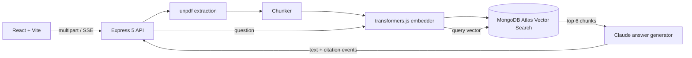

# rag-docs-chat

Chat with your PDFs: retrieval-augmented answers from Claude with MongoDB Atlas Vector Search, streamed token by token with citations back to the source page.

[](https://github.com/Muhaman/rag-docs-chat/actions/workflows/ci.yml)

## What it does

- Upload a PDF (up to 10 MB). Text is extracted per page, split into overlapping chunks, embedded locally with `Xenova/all-MiniLM-L6-v2` (384-d) and stored in MongoDB.
- Ask a question. The top 6 chunks are retrieved by cosine similarity, optionally restricted to selected documents, and sent to Claude as `document` blocks with citations enabled.
- The answer streams over Server-Sent Events. Each citation names the document, page and quoted passage.
- If nothing is retrieved, the API replies "No relevant documents" without calling the model.

## Architecture



The embedder, vector store and answer generator are interfaces injected through `createApp(deps)`, so tests run against a deterministic fake embedder, an in-memory store and a scripted generator.

## Quickstart

Requires Docker and an Anthropic API key.

```bash
export ANTHROPIC_API_KEY=sk-ant-...
docker compose up --build
```

Open http://localhost:8080. The first upload downloads the embedding model (cached in a volume).

Local development (Node 24, a MongoDB Atlas Local container on port 27017):

```bash
cp .env.example .env   # fill in ANTHROPIC_API_KEY
npm install
npm run dev:server
npm run dev:web        # http://localhost:5173, proxies /v1 to :3000
```

## Usage / API

```bash
# Ingest
curl -F file=@report.pdf http://localhost:3000/v1/documents
# => 201 {"id":"...","name":"report.pdf","pages":12,"chunks":31,"createdAt":"..."}

curl http://localhost:3000/v1/documents
curl -X DELETE http://localhost:3000/v1/documents/<id>     # 204

# Ask (SSE: text, citation, done, error)
curl -N -H 'content-type: application/json' \
  -d '{"question":"What is the renovation budget?","docIds":["<id>"]}' \
  http://localhost:3000/v1/chat
```

Errors use `{ "error": { "code", "message" } }`: 415 for non-PDF, 413 over 10 MB, 400 for empty or invalid input. Stream failures arrive as an `error` event, for example `refusal` or `max_tokens`.

## Design decisions & trade-offs

- **Local embeddings.** transformers.js keeps ingestion free and offline after the first model download, at the cost of a slow first request and a glibc-based (Debian) server image.
- **Native citations over prompt-parsed ones.** Each retrieved chunk is a plain-text `document` block, so citations come back as structured character locations mapped to document and page, not model-formatted strings.
- **Chunking.** Paragraph, then sentence, then hard cut at 3200 characters with 480 characters of overlap; chunks never cross pages so page attribution stays exact.
- **Typed failure modes.** A `refusal` or `max_tokens` stop reason becomes a typed error surfaced as an SSE `error` event, never a silently empty answer. Server-side refusal fallback is enabled.
- **Disconnect propagation.** Closing the SSE connection aborts the upstream Claude request through an `AbortSignal`.
- **Dependency injection.** Swapping the store or generator needs no route changes; the Mongo store is the only piece that needs a real Atlas Local instance.

## Testing

```bash
npm install
npm run lint && npm run typecheck && npm test
```

Server tests cover chunking, the in-memory store, upload validation (415 / 413 / 400 / 201 with a PDF built in the test), chat streaming, the empty-retrieval reply, abort propagation, refusal handling and env validation. The web package is typechecked only. CI runs lint, typecheck, tests and both Docker builds.

## Limitations & next steps

- The Mongo store and the Claude generator are not exercised in CI (they need Atlas Local and an API key).
- Scanned PDFs without a text layer are rejected (422); there is no OCR.
- No authentication or per-user document isolation; the rate limit is a single global per-IP bucket.
- Search index creation is asynchronous, so queries right after the very first startup may return nothing for a few seconds.
- Next steps: reranking, hybrid lexical plus vector search, conversation memory, and per-user collections.

## License

MIT
